# Cloud Mail 中文图解部署教程

**客户保留 DNS / NS · 共用一个 Cloudflare 账号 · 每客户独立项目**

本教程用 **kinghh.cn** 演示，邮箱管理员是 **admin@kinghh.cn**，正式网页登录地址是 [mail.kinghh.cn](https://mail.kinghh.cn)。

> **kinghh.cn 已经上线，仅用作教程示例，不要重复新建、重新初始化或清库。** 下一位客户请把示例域名统一替换为客户实际域名；不要复制本客户的密钥、激活码、DKIM 或证书验证值。

本页插图是**中文对照界面示意，不是真实截图**。GitHub、Cloudflare 部分固定按钮可能仍显示英文，本页保留原文以便找到对应按钮。变量名、参数名、分支名和阶段值必须按原文填写，不能翻译成中文。

## 先理解“一键”自动到哪里

- **自动完成**：只读检查、构建、独立 Worker 程序 / D1 数据库 / KV 存储、初始化新库、Resend 域名与收信通知接口、DNS 清单、验证和激活通知。
- **仍需操作**：首次授权、本人审批、客户填写 DNS、设置管理员密码；正式的 `mail.客户域名` 还需完成自定义主机名、证书和精确路由。
- **不需要**：客户转移域名账号、更换 NS 或覆盖原网站解析。
- **收发信服务商**：本仓库使用 Resend；不要混用原仓库的 CF 原生收发配置。

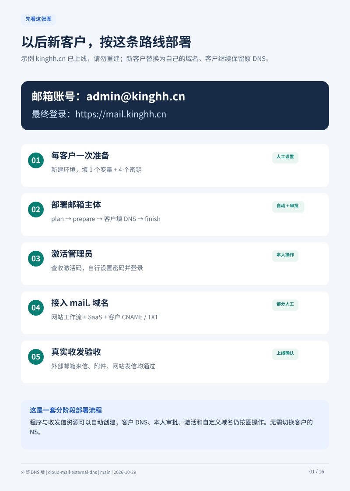

## 常用入口

| 需要做什么 | 打开哪里 |
|---|---|
| 新客户检查 / 创建 / 完成开通 | [新建客户邮箱（外部 DNS）](https://github.com/iwxh/cloud-mail-external-dns/actions/workflows/new-external-mail.yml) |
| 已有项目增加网页登录域名 | [添加邮箱网页登录域名](https://github.com/iwxh/cloud-mail-external-dns/actions/workflows/add-external-website.yml) |
| 更详细的部署保护与限制 | [文字部署说明](EXTERNAL-DNS-DEPLOY.md) |

## 第 1 步：确认邮箱后缀和原有邮箱

本教程所有填写值都遵循下表。

| 字段 | 演示填写值 |
|---|---|
| 邮箱后缀 | `@kinghh.cn` |
| 管理员 | `admin@kinghh.cn` |
| 邮箱域名参数 `domain` | `kinghh.cn` |
| 客户环境 | `external-kinghh.cn` |
| 网页登录域名 | `mail.kinghh.cn` |
| 分支 | `main` |

先核对客户是否已有根域 MX。已有企业邮箱时，先安排迁移或使用独立邮箱子域；部署器遇到冲突会停止，不会自动接管。**不能混填两家 MX，指望它们按不同用户名分流。**

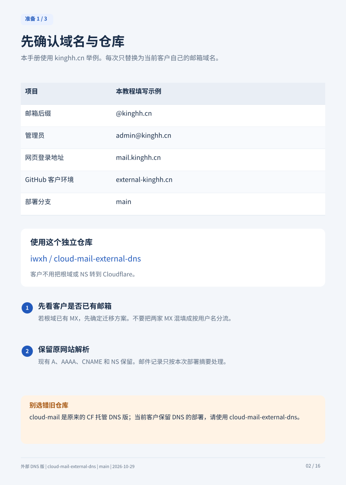

## 第 2 步：每个客户新建一个 GitHub 环境

1. 打开仓库的 **设置（Settings）**。
2. 左侧打开 **环境（Environments）**。
3. 点击 **新建环境（New environment）**。
4. 名称填写 `external-kinghh.cn`，点击 **配置环境（Configure environment）**。
5. 勾选 **指定审批者（Required reviewers）**，选择你本人。
6. 取消 **允许管理员绕过（Allow administrators to bypass configured protection rules）**。
7. 部署分支选择 **所选分支和标签（Selected branches and tags）**，只添加 `main`，保存。

如果由你自己发起并由你审批，**禁止自我审批（Prevent self-review）保持关闭**；否则不能批准自己发起的运行。

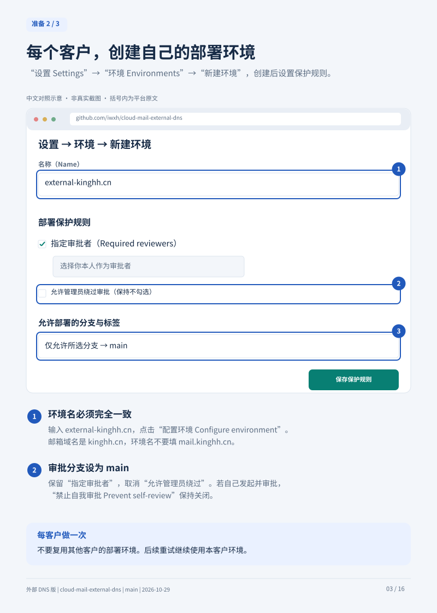

## 第 3 步：填写 1 个变量、4 个环境密钥

仍在本客户环境内，不是在旧仓库，也不是在别人的客户环境。

### 环境变量（Variables）

| 名称，必须保留英文 | 值 |
|---|---|
| `CUSTOMER_DOMAIN` | `kinghh.cn` |

### 环境密钥（Secrets）

点击 **新增环境密钥（Add environment secret）**，每次填写名称与值，再保存。

| 名称，必须保留英文 | 该填什么 |
|---|---|
| `CLOUDFLARE_ACCOUNT_ID` | 你共用的 CF 账号标识 |
| `CLOUDFLARE_API_TOKEN` | 这个独立仓库专用的部署令牌，先确认未过期 |
| `RESEND_API_KEY` | 本客户配置的 Resend 完全访问密钥（Full access） |
| `MAIL_OWNER_EMAIL` | 你已经能收信的外部邮箱，例如现有 QQ / Gmail；用于接收激活通知 |

### 这四项从哪里获取

#### ① CLOUDFLARE_ACCOUNT_ID：复制 CF 账号标识

1. 登录 [Cloudflare 控制台](https://dash.cloudflare.com/)，选择实际部署邮箱的那个账号。
2. 按 `Ctrl + K` 打开搜索，输入 `Copy account ID`，选择“复制账户 ID”。
3. 也可以打开 **Workers & Pages → Account Details（账号详情）→ Account ID**，点击复制。
4. 把复制的账号 ID 填到 GitHub 环境的 `CLOUDFLARE_ACCOUNT_ID`。

注意要复制 **Account ID（账号 ID）**，不是 **Zone ID（区域 ID）**。同一 CF 账号下的客户可以复用这个值。

依据：[CF 官方账号 ID 获取说明](https://developers.cloudflare.com/fundamentals/account/find-account-and-zone-ids/)。

#### ② CLOUDFLARE_API_TOKEN：创建或使用现有部署令牌

1. 打开 [CF 个人 API 令牌页面](https://dash.cloudflare.com/profile/api-tokens)。
2. 点击 **Create Token（创建令牌）→ Create Custom Token（创建自定义令牌）**。
3. 名称可填 `cloud-mail-external-dns-deploy`；选择实际使用的 **指定 CF 账号**作为账号资源范围。
4. 当前部署器已验证使用的账号权限如下；它需要创建和管理新资源，不能只授权某一个已经存在的 Worker。

| 权限类别 | 权限名称 | 级别 |
|---|---|---|
| Account（账号） | Workers Scripts | Edit（编辑） |
| Account（账号） | D1 | Edit（编辑） |
| Account（账号） | Workers KV Storage | Edit（编辑） |
| Account（账号） | Workers AI | Edit（编辑） |

5. 设置适当有效期，核对权限摘要后，由你本人创建令牌。
6. 复制本次生成的**完整 Token 值**，保存到安全的密钥管理处，再填入 GitHub 环境的 `CLOUDFLARE_API_TOKEN`。不要复制令牌的名称或令牌 ID。

当前外部 DNS 部署器不需要 DNS 编辑、CF Email Routing 或 CF 原生发信权限。不要使用 Global API Key（全局 API 密钥）。若面板使用新版 Worker 资源角色，创建新 Worker 需要产品级 Admin 权限，单个已有 Worker 的 Editor 不能代替新建权限。

同一个仓库、同一个 CF 账号的后续客户，可以使用仍有效且权限匹配的专用部署令牌；无需每客户都重新生成。CF 只在创建时展示令牌原值；若你未保留原值，不能从旧令牌列表重新查看。新建令牌不要同时删除旧项目仍在使用的令牌。

依据：[CF 创建令牌](https://developers.cloudflare.com/fundamentals/api/get-started/create-token/)、[账号权限列表](https://developers.cloudflare.com/fundamentals/api/reference/permissions/)、[新版 Worker 角色说明](https://developers.cloudflare.com/workers/authorization/workers/)。

#### ③ RESEND_API_KEY：在 Resend 创建本客户密钥

1. 打开 [Resend API Keys](https://resend.com/api-keys)，登录正确的团队。
2. 点击 **Create API Key（创建 API 密钥）**。名称例如 `kinghh-cn-external-dns`。
3. 权限选择 **Full access（完全访问）**。当前程序还要管理域名、通知接口和读取来信，**仅发信 Sending access 不够**。
4. 创建后复制本次显示的完整 Key，通常以 `re_` 开头，填入 GitHub 环境的 `RESEND_API_KEY`。

复制的是 **Key 值**，不是名称、Key ID、Domain ID 或 Webhook Signing Secret。创建后不能重新查看原值；如果未保存，可以新建一把，再核对使用范围，不要直接删除旧项目正在使用的 Key。

建议每客户单独命名和配置，便于追踪。但 Full access 仍有该 Resend 团队的管理及邮件读取权限，并不因名称包含 kinghh.cn 就变成域名级隔离。已部署客户更换 Key 要按凭据迁移处理，不能只替换 GitHub Secret 后盲目重跑。

依据：[Resend 管理 API Key](https://resend.com/docs/dashboard/api-keys/introduction)、[权限说明](https://resend.com/docs/api-reference/api-keys/create-api-key)。

#### ④ MAIL_OWNER_EMAIL：填写你自己的现有收件邮箱

这不是需要申请的密钥。直接填你本人或客户已经能正常收信的完整 QQ / Gmail 等外部邮箱，用来接收管理员激活通知。

只填邮箱地址，不填邮箱密码、QQ 授权码或 SMTP 密码。不要把尚未开通的新项目管理员邮箱作为唯一激活通知地址；同一通知邮箱可以用于多个客户。

#### 最后填到 GitHub 哪里

本仓库 **Settings（设置）→ Environments（环境）→ external-kinghh.cn → Environment secrets（环境密钥）→ Add environment secret（新增）**。Name 填上表准确名称，Value 填对应值，逐项保存。

`kinghh.cn` 已经配置并上线，现有环境保留原值即可。新客户新建自己的 `external-客户域名` 环境；不要把这些值加到公开代码、Variables 或工作流输入框。保存后的 Secret 不显示原值，部署前只核对名称是否齐全。

不要把尚未激活的 `admin@kinghh.cn` 当作唯一激活通知地址。密码、令牌和激活码由你本人粘贴到平台，**不要提交到仓库、聊天、截图或工作流输入框**。

CF 令牌需要同一账号的 **Workers Scripts、D1、KV、Workers AI 编辑权限**；当前外部 DNS 模式不需要 DNS 编辑、CF 邮件路由或 CF 原生发信权限。令牌只供工作流使用，不进入客户 Worker。

Resend 需有可用的域名、通知接口和邮件额度。Full access 密钥在同一 Resend 团队内仍有团队级权限；若服务商账号权限也要隔离，客户应使用独立 Resend 团队。

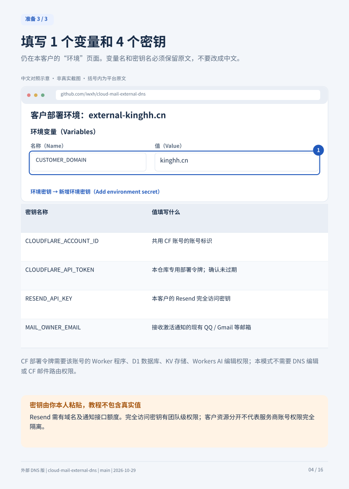

## 第 4 步：先运行只读检查 plan

1. 打开 **自动化（Actions）**。
2. 左侧选择 **新建客户邮箱（外部 DNS）**。
3. 点击右侧 **运行工作流（Run workflow）**。
4. 分支选择 `main`，邮箱域名填 `kinghh.cn`，阶段先选 `plan`。
5. 点击绿色 **Run workflow**，打开刚出现的运行记录。

| 阶段值，必须保留英文 | 中文含义 | 是否创建资源 |
|---|---|---|
| `plan` | 只读检查 | 不创建 |
| `prepare` | 创建独立项目，返回 DNS 清单 | 创建当前客户资源 |
| `finish` | 验证 DNS、服务商认证并发送激活通知 | 复用已创建项目 |

域名只填小写 `kinghh.cn`，不要填 `https://`、网页路径、空格、通配符或 `mail.kinghh.cn`。本教程邮箱后缀是 `@kinghh.cn`，与网页登录地址不同。

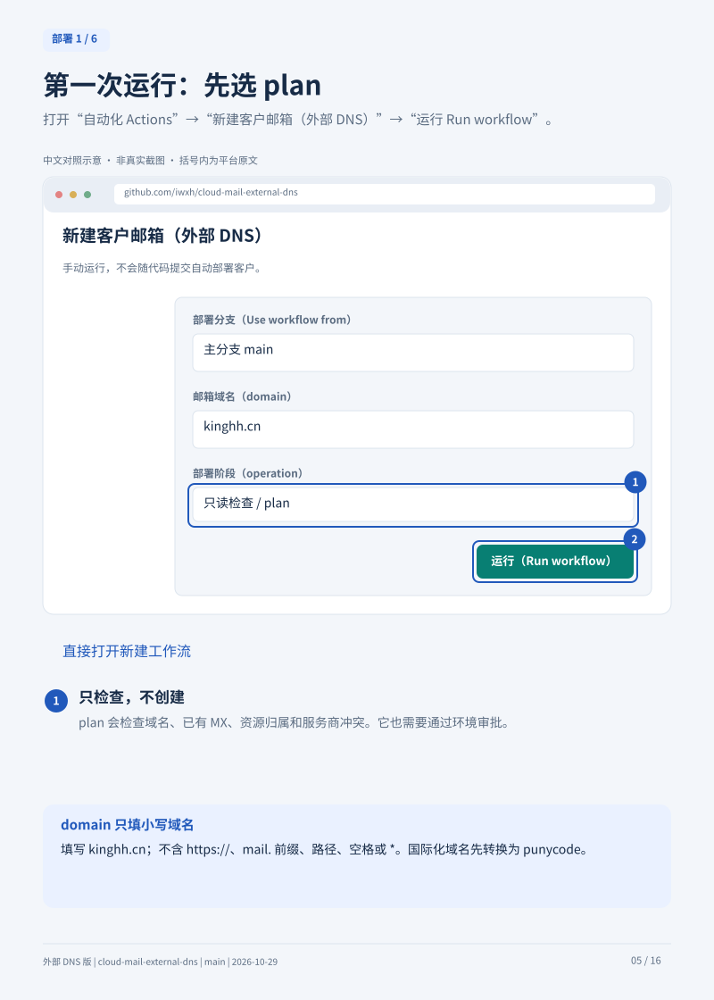

## 第 5 步：处理等待审批

每次新建或重试都可能要求本人审批，`plan` 也使用受保护环境。

1. 在本次运行页看到 **等待审批（Waiting for review）**。
2. 点击 **审阅部署（Review deployments）**。
3. 勾选当前客户环境 `external-kinghh.cn`。
4. 核对仓库、客户域名与本次操作。
5. 点击绿色 **批准并部署（Approve and deploy 1）**。

若没有按钮，先确认当前 GitHub 登录账号就是指定审批者。不要为了跳过审批而关闭保护规则。

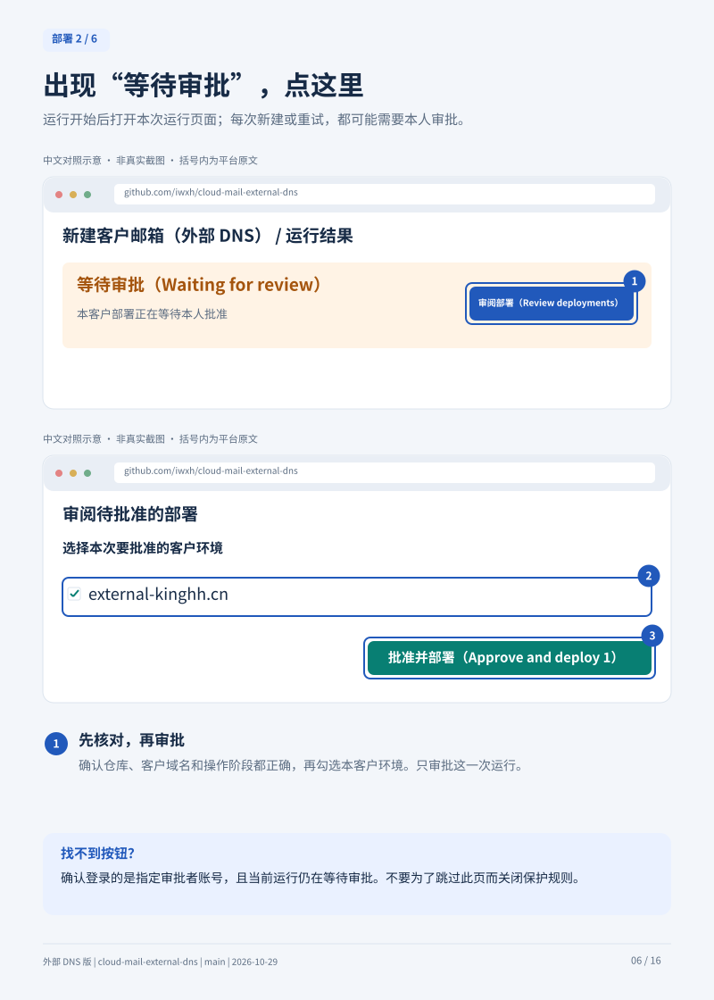

## 第 6 步：只读检查通过后，运行 prepare

重新打开同一个工作流，仍选择 `main`、同一个域名，把阶段改为 **`prepare`**，运行并审批。

创建完成后查看 **运行摘要（Summary）**，保存：

- 系统地址；地址第一段就是客户 Worker 名。
- 本次生成的邮件 DNS 清单。
- 本次运行的完整 40 位源码 SHA；可从运行顶部的短版本号进入提交页复制。新版中文摘要也会显示本次运行源码 SHA。
- 本次运行链接；D1 / KV 可在对应 Worker 的绑定页核对。

看到 **程序已部署，等待客户填写 DNS（waiting_for_customer_dns）** 是正常中间状态，**此时邮箱还没全部开通**。

prepare 与后续 finish 期间，不要更新 main 的运行代码。旧客户的当前部署 SHA 应以客户部署记录为准，不能直接拿最新 main 替代。

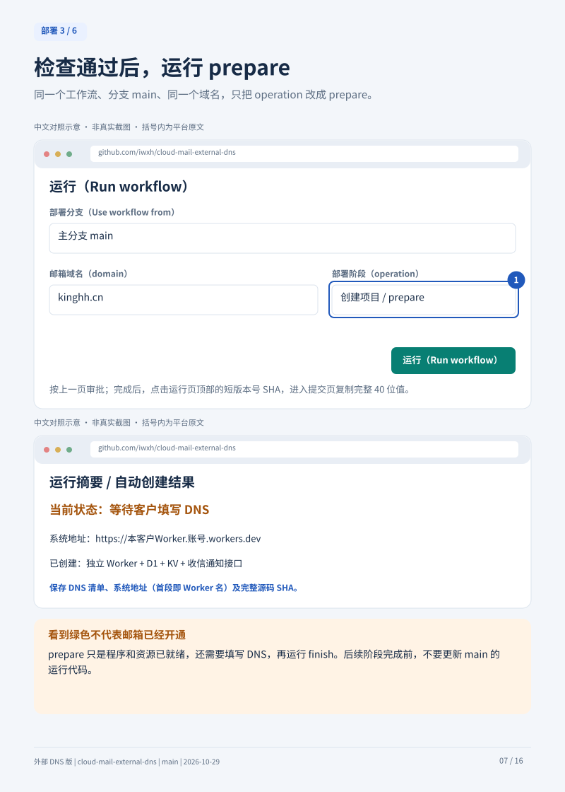

## 第 7 步：客户在原 DNS 平台填写邮件记录

将运行摘要的清单交给客户。类型、完整名称、值与 MX 优先级全部以**本次真实输出**为准。

- 邮箱后缀是 `@kinghh.cn`，根域收信 MX 的主机记录填 **`@`**。
- 不要因为网页登录叫 `mail.kinghh.cn`，就把收信 MX 填到 `mail`。
- DNS 后台自动补域名时，只填主机记录部分，避免出现重复后缀。
- 遇到已有 SPF、DMARC、旧 MX 或同名冲突，先审阅迁移 / 合并方案，不能直接重复或覆盖。
- 原网站 A / AAAA / CNAME 和 NS 保留。
- 不要把截图中的占位说明、别人的 DKIM 或证书验证值当作可复制的配置。

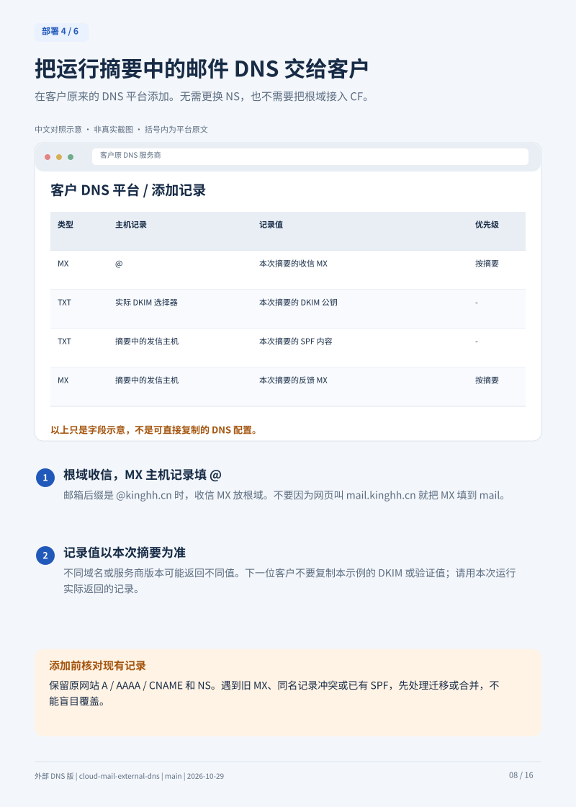

## 第 8 步：解析生效后，运行 finish

仍用同一个工作流：`main` + `kinghh.cn` + **`finish`**，然后本人审批。

程序核对公网 DNS 与 Resend 认证，再提交激活通知。认证是异步的，最多等待约 20 分钟；超时后核对实际解析，再重试 finish，复用已有资源，不删库重建。

| 运行状态 | 含义与下一步 |
|---|---|
| `read_only_plan` | 只读检查完成 |
| `waiting_for_customer_dns` | 程序已部署，客户仍需填写邮件 DNS |
| `activation_email_accepted` | 激活通知已提交，去通知邮箱检查收件箱和垃圾箱 |
| `already_active` | 管理员已经激活，直接登录 |
| `website_runtime_ready_dns_tls_pending` | 网站程序已适配，仍需域名、路由与证书 |

若 main 已更新运行代码，不要盲目用新版重建。prepare 重试受原始源码保护；plan / finish 只允许经校验、运行代码和初始化结构不变的兼容后续版本。

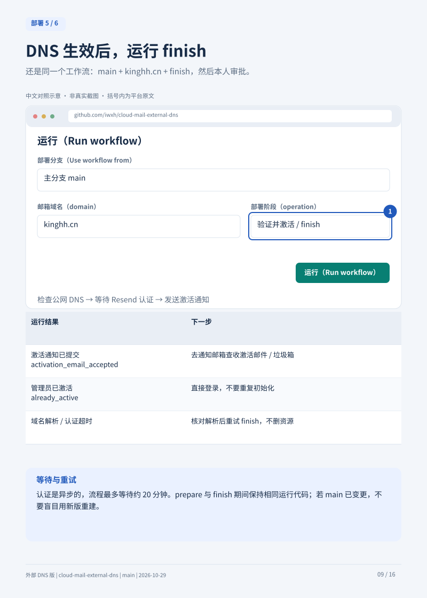

## 第 9 步：激活管理员并登录

1. 到 `MAIL_OWNER_EMAIL` 对应的现有外部邮箱查收激活通知，也检查垃圾箱。
2. 打开运行摘要中的系统地址，再进入 **`/setup`**。
3. 第一栏 **激活码（Activation code）**，粘贴邮件里完整 **64 位**激活码。
4. 第二栏设置 **12-30 字符**新密码。
5. 第三栏再次填写相同密码，点击 **激活管理员（Activate admin）**。
6. 打开 `/login` 登录。登录框已带 `@kinghh.cn` 后缀时，只填 `admin`；没有后缀时填 `admin@kinghh.cn`。

激活码有效 24 小时；未激活时重试 finish 会生成新码，旧码失效。使用最新邮件，不要截短激活码。已激活项目不要重复初始化，**不要使用旧项目教程中的 `/api/init/密钥`**。

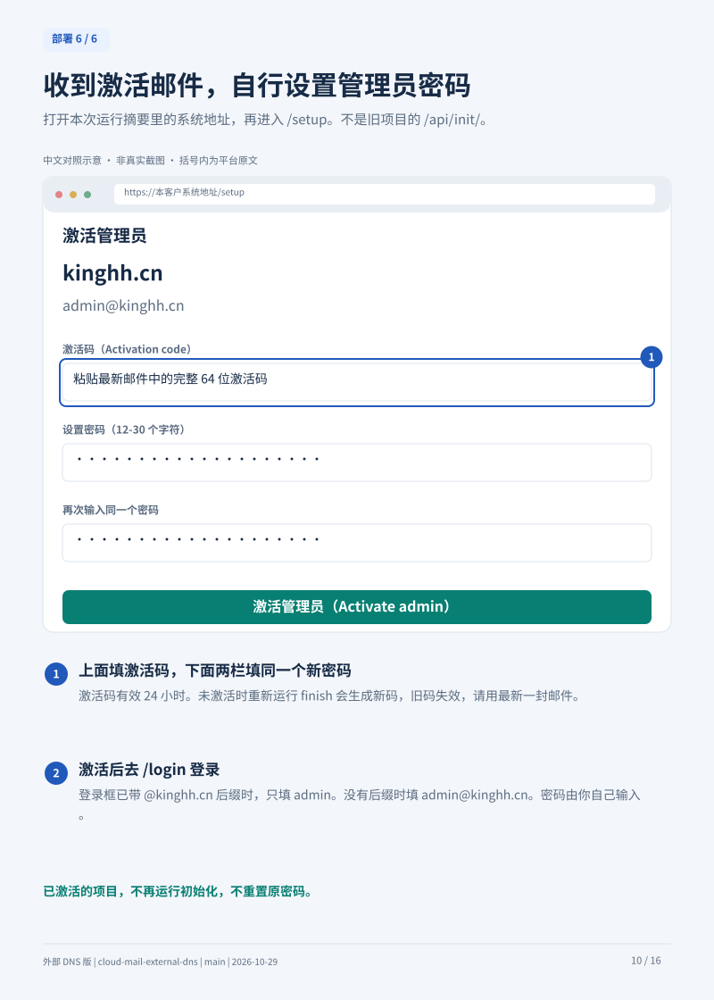

## 第 10 步：添加 mail.kinghh.cn 的程序支持

先完成管理员激活，再打开 **添加邮箱网页登录域名** 工作流，分支仍为 `main`。

| 参数名 | 示例填写 |
|---|---|
| `domain` | `kinghh.cn` |
| `website_hostname` | `mail.kinghh.cn` |
| `expected_deployed_commit` | 这个客户当前已部署源码的完整 40 位 SHA |

最后一项不是 CF 的版本 UUID，也不是默认填最新 main。运行后本人审批，结果显示“程序适配完成，等待 DNS / 证书”时，继续后面步骤。

本工作流保留原始系统地址和签名收信接口，原账号、密码、数据库和邮件继续使用。**不要把 `EXTERNAL_WEBSITE_HOST` 手改成新域名**，否则可能破坏收信回调。

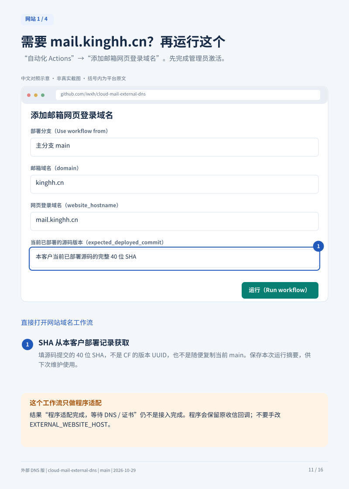

## 第 11 步：CF 接入域添加自定义主机名

你当前账号的接入域是 **iwxh.cc**，已启用 Cloudflare for SaaS。后续客户复用现有底座，不重复开通套餐，也不改掉现有回源配置。

1. CF 选择接入域 `iwxh.cc`。
2. 打开 **SSL/TLS → 自定义主机名（Custom Hostnames）**。
3. 点击添加，客户主机名填 `mail.kinghh.cn`。
4. 最低 TLS 版本选 **1.2**，托管证书使用 **TXT 验证**，默认回源。
5. 保存后，记录本客户返回的域名归属验证 TXT 与证书验证 TXT。

当前接入目标为 **`external-mail-origin.iwxh.cc`**。这是你当前 CF 账号已配置的网页接入目标，**不是邮件 MX，也不是所有其他账号通用的配置**。底层 CF 代理回源记录由运营方维护，客户不要照抄到自己的根域。

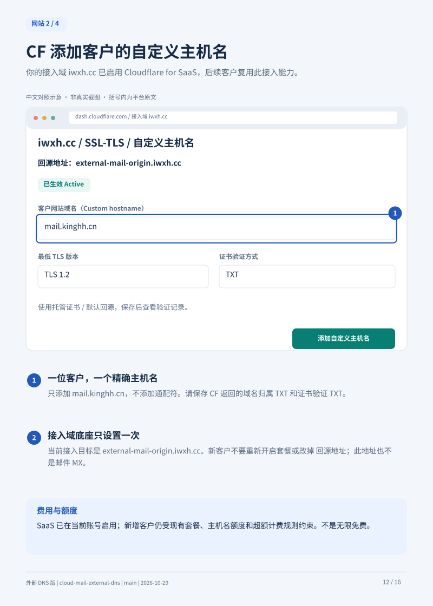

## 第 12 步：客户 DNS 添加网页登录记录

保留已有邮件 MX / SPF / DKIM，再增加网站记录。

| 类型 | 客户 DNS 主机记录 | 记录值 |
|---|---|---|
| CNAME | `mail` | `external-mail-origin.iwxh.cc`，仅适用于当前接入账号 |
| TXT | `_cf-custom-hostname.mail` | 本客户 CF 页面返回的域名归属验证值 |
| TXT | `_acme-challenge.mail` | 本客户返回的证书验证值 |
| TXT | `_acme-challenge.mail` | 若返回第二个值，也单独添加并保留第一条 |

以上验证值每个客户不同，教程不包含可复制的 Token。**不能只把 CNAME 指向 workers.dev 来代替自定义主机名、证书与路由接入。**

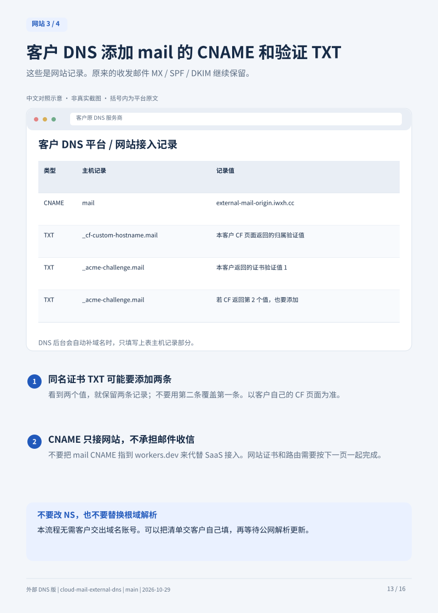

## 第 13 步：精确路由与 HTTPS

在接入域 `iwxh.cc` 完成：

1. 打开 **Worker 路由**（Workers Routes），添加 `mail.kinghh.cn/*`。
2. 选这个客户自己的 `xm-mail-...` Worker，保存；不要选旧项目，也不添加泛域或全站路由。
3. **规则 → 重定向规则（Redirect Rules）**，仅匹配 `http://mail.kinghh.cn/*`。
4. 目标 `https://mail.kinghh.cn/${1}`，状态码 **308**，开启 **保留查询参数（Preserve query string）**。
5. 核对回源地址、客户主机名与 HTTPS 证书都为 **已生效（Active）**。
6. 打开 `https://mail.kinghh.cn/login`，用原账号、原密码登录。新网页地址不会改变邮箱后缀。

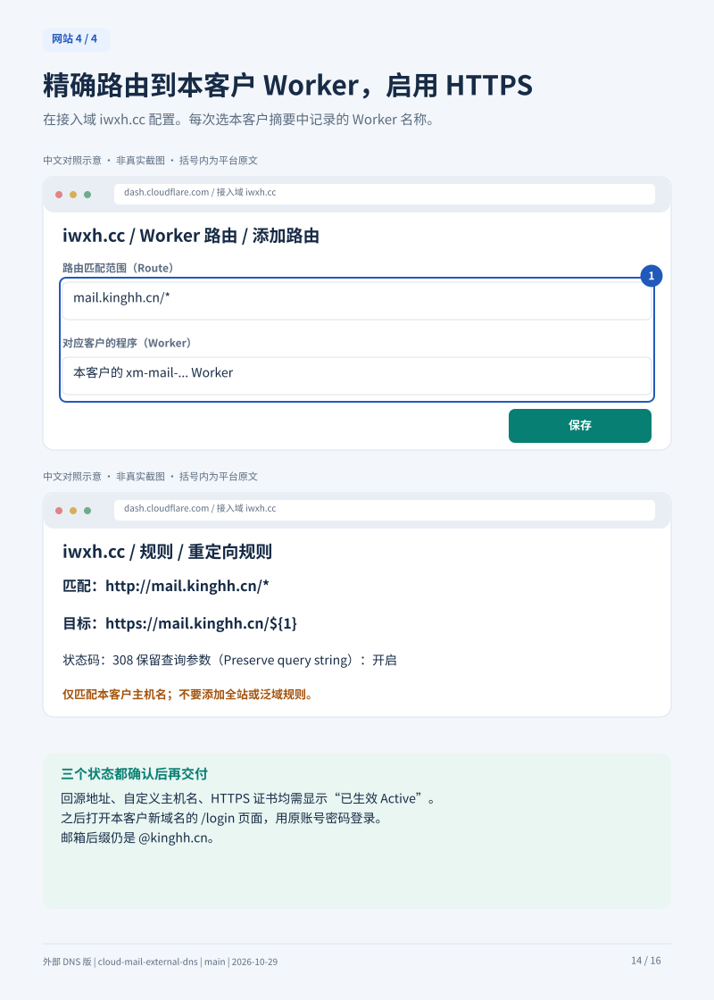

## 第 14 步：真实收发验收

- 从外部 QQ / Gmail / 88 发一封新邮件到管理员，网页实际收到。
- 正文和附件能正常查看、下载。
- 从正式网站发到外部邮箱，对方实际收到；不能仅看“发送成功”。
- 客户原网站解析、NS 和其他客户项目保持正常。

本外部 DNS 版本首版自动转发默认关闭，需要另行适配。CF 与 Resend 的账号额度、账单仍共享；独立资源不等于独立服务商账号。

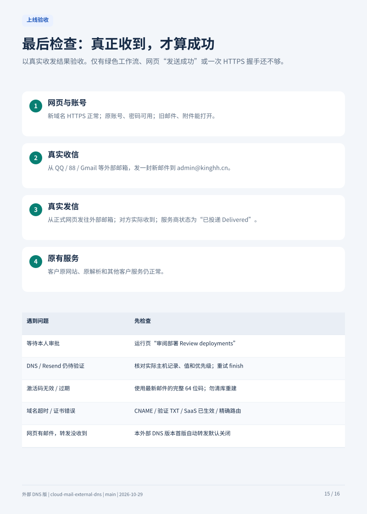

## 第 15 步：每客户保存一份记录

保存邮箱域名、管理员、客户环境、prepare / finish 运行链接、当前完整部署 SHA、Worker / D1 / KV 名、原始系统地址、正式登录地址与验收日期。**不要在部署记录中保存密码、令牌或激活码。**

当前仓库提交 main 只做检查与打包，不会自动给已上线客户发版。已有项目更新应单独核对该客户部署记录并使用相应受保护流程。

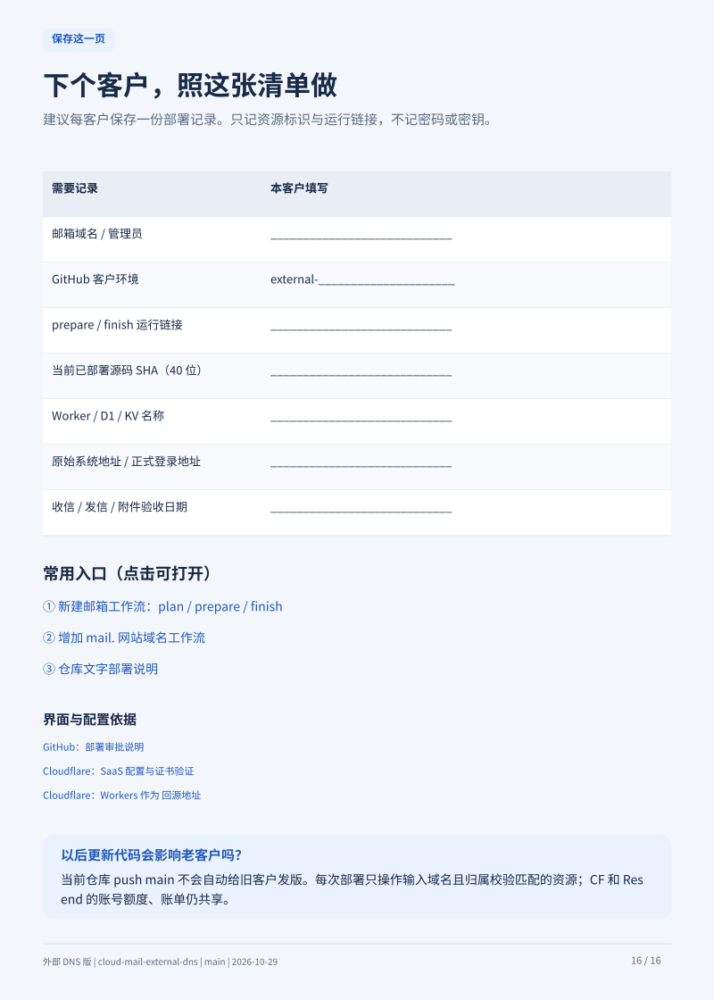

## 平台按钮中文对照

| 平台原文 | 中文含义 |
|---|---|
| Settings / Environments | 设置 / 客户部署环境 |
| Variables / Secrets | 环境变量 / 环境密钥 |
| Actions / Run workflow | 自动化 / 运行工作流 |
| Waiting for review | 等待本人审批 |
| Review deployments | 审阅待部署项目 |
| Approve and deploy 1 | 批准并部署本次运行 |
| Summary | 运行摘要 |
| Full access | 完全访问权限 |
| Custom Hostnames / Fallback origin | 自定义主机名 / 回源地址 |
| Workers Routes / Redirect Rules | Worker 路由 / 重定向规则 |
| Active / Delivered | 已生效 / 已投递 |

依据：[GitHub 部署审批说明](https://docs.github.com/en/actions/how-tos/deploy/configure-and-manage-deployments/review-deployments)、[Cloudflare SaaS 配置](https://developers.cloudflare.com/cloudflare-for-platforms/cloudflare-for-saas/start/getting-started/)、[Workers 作为回源](https://developers.cloudflare.com/cloudflare-for-platforms/cloudflare-for-saas/start/advanced-settings/worker-as-origin/)。
